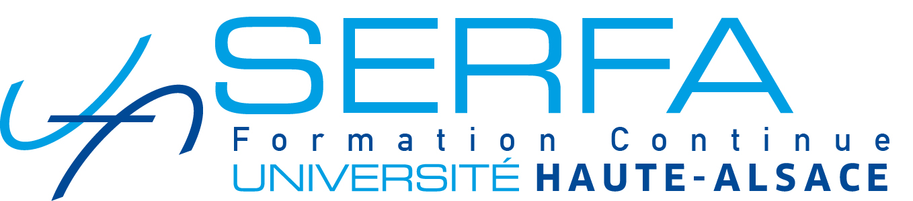

<div align="center">

<!-- Logos des partenaires (ajustez les chemins si besoin) -->
<p align="center">
  
  &nbsp;&nbsp;&nbsp;&nbsp;
  
  &nbsp;&nbsp;&nbsp;&nbsp;
  
</p>

# 🎓 Mémoire de Licence — [Titre de votre mémoire]
### *Bachelor's Thesis — [English Title of Your Thesis]*

[](#)
[](#)
[](#)
[](#)
[](#)
[](#)
[](#)
[](#)
[](#)
[](#)
[](#)
[](#)
[](#)
[](#)
[](#)
[](#)
[](#)
[](#)
[](#)
[](#)
[](#)
[](#)

</div>

---

## 📌 Contexte Académique & Professionnel

* **Auteur :** Michael Lienhart
* **Diplôme :** Licence Professionnelle / Bachelor's Degree — [Intitulé exact de votre formation]
* **Établissement :** Université de Haute-Alsace (UHA 4.0) / SERFA
* **Entreprise d'accueil :** MonWebPro
* **Année universitaire :** 2026 – 2027
* **Encadrement :** [Nom du tuteur pédagogique] (UHA/SERFA) & [Nom du tuteur entreprise] (MonWebPro)

---


---

## 📖 Résumé (Abstract)

> **🇫🇷 Français :**  
> Ce mémoire présente les travaux réalisés au sein de **MonWebPro** dans le cadre de ma licence à l'**UHA 4.0 / SERFA**. L'objectif principal de ce projet était de [décrire en 2-3 phrases la problématique principale, la solution développée et les résultats obtenus].

> **🇬🇧 English :**  
> *This Bachelor's thesis presents the work carried out at **MonWebPro** as part of my degree at **UHA 4.0 / SERFA**. The main objective of this project was to [summarize the problem, solution, and key outcomes in 2-3 sentences].*

---

## 🛠️ Technologies & Compétences Mobilisées

* **Développement Web / Logiciel :** `[Ex: HTML5, CSS3, JavaScript, PHP, SQL, ...]`
* **Outils & DevOps :** `[Ex: Git, GitHub, Docker, VS Code...]`
* **Rédaction & Mise en page :** LaTeX
* **Méthodologie :** `[Ex: Gestion de projet Agile, Analyse des besoins, UX/UI...]`

---

## 📂 Structure du Dépôt

```text
├── 📄 memoire-licence.pdf      # Version finale compilée du mémoire
└── 📁 images/                  # Figures, schémas et logos utilisés
```

---

## 📥 Téléchargement & Consultation

* 👉 **[Télécharger ou lire le mémoire complet au format PDF](./EasyBetMe-1.pdf)** *(Pensez à renommer votre fichier sans espaces)*

---

## ⚖️ Droits d'auteur & Confidentialité

Ce document a été rédigé à des fins académiques. Certaines données sensibles ou propres à l'entreprise **MonWebPro** ont été anonymisées ou retirées conformément aux règles de confidentialité.

---

<div align="center">
  <sub>© 2026–2027 — Michael Lienhart | <a href="https://lienhartm.github.io/lm/">WebSite LM</a></sub>
</div>
